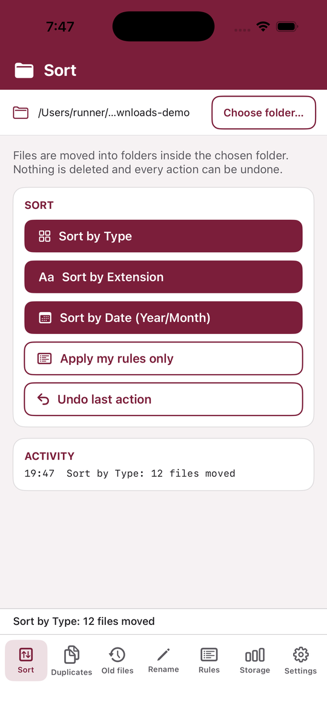
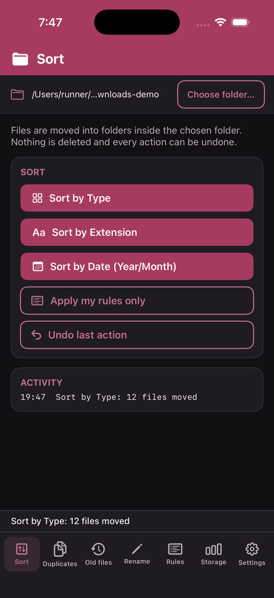
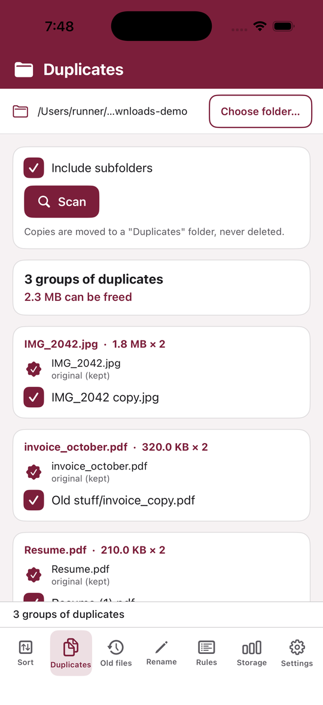
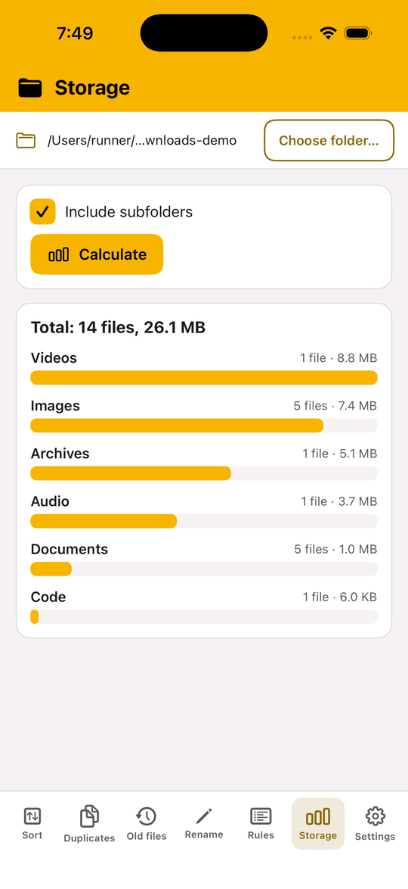
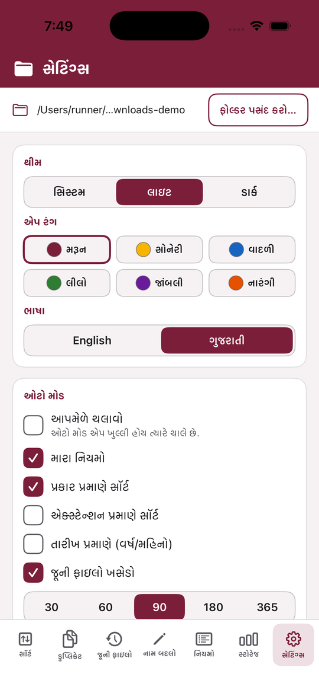
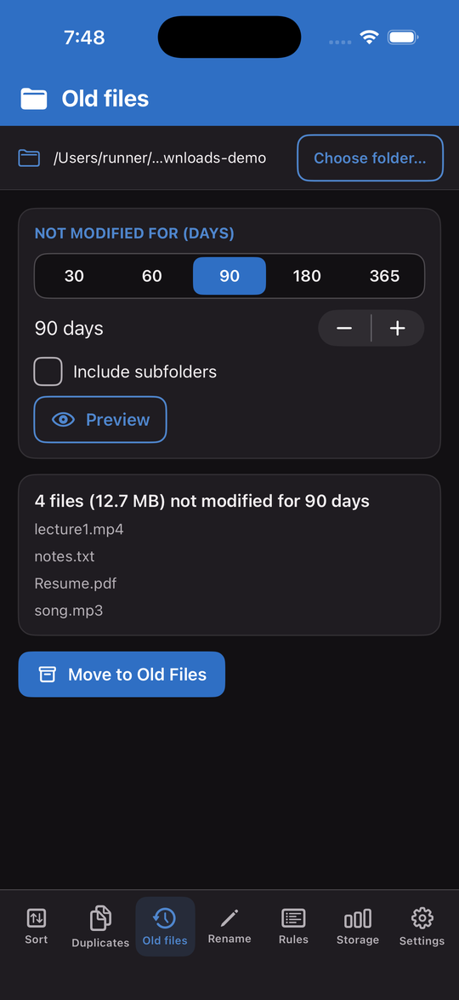

<p align="center">
  
</p>

<h1 align="center">Darshan File Manager for iOS</h1>

<p align="center">
  Keep any folder tidy: sort by type, extension or date, find duplicates, clear old files, batch rename, your own rules — with Undo for everything. English and ગુજરાતી, light / dark / system theme and six accent colours.
</p>

<p align="center">
  
  
  
  
</p>

---

## ✨ Features

| | Feature | What it does |
|---|---|---|
| 🗂 | **Sort by Type** | `Images`, `Videos`, `Audio`, `Documents`, `Archives`, `Code`, `Others` |
| 🔤 | **Sort by Extension** | One folder per extension (`JPG`, `PDF`, `MP4`, …; `.tar.gz` handled) |
| 📅 | **Sort by Date** | `Year/MM-Month` folders from the modified date, e.g. `2026/11-November` |
| 👯 | **Duplicate finder** | Same size, then SHA-256; shows the space you can free; moves copies to `Duplicates` — **never deletes**, always keeps one original |
| 🧹 | **Old files cleaner** | Files not modified for 30 / 60 / 90 / 180 / 365 / custom days → `Old Files`, with a preview first |
| ✏️ | **Batch rename** | Filter by name / extension, prefix, suffix, find → replace, numbering (`Photo_001`), preview before applying |
| 🧩 | **My rules** | "extension is jpg, png" or "name contains invoice" → any folder, applied **before** the built-in types (first match wins) |
| 📊 | **Storage usage** | Count and size per category as a bar chart |
| ↩ | **Undo** | Every action (sort, duplicates, old files, rename, auto run) can be undone; the undo history survives restarts |
| ⏱ | **Auto mode** | Tick what runs automatically (rules, type / extension, date, old files, duplicates) + notification such as *“12 sorted, 3 duplicates moved, 5 old files moved”* |
| 🎨 | **Themes** | Light / Dark / System and accent colours Maroon (default), Gold, Blue, Green, Purple, Orange — checked for readable contrast |
| 🌐 | **Language** | English / ગુજરાતી, switches immediately |

### Safe by design
- Never overwrites: a name clash becomes `file (1).jpg`.
- Never deletes anything. Duplicates and old files are *moved* into folders inside the folder you chose.
- Skips hidden files, system files and files that are still downloading (`.crdownload`, `.part`, `.tmp`).
- Refuses to run on the disk root or system folders in Auto mode.
- No internet, no accounts, no telemetry.

## 📸 Screenshots








Screenshots are produced by the CI build itself (the real app, launched in demo mode with a sample folder).

---

## ⬇️ Install

This is an iPhone / iPad app (iOS 16+). Apple only allows installing apps that are signed, so:

- **With a Mac + Xcode:** open this repo, run `brew install xcodegen && xcodegen generate`, open `DarshanFileManager.xcodeproj`, choose your iPhone and press Run (a free Apple ID is enough for 7-day personal installs).
- **Without a Mac:** there is no binary to download. A free *simulator* build is produced by CI only to prove that the code compiles and runs; a real iPhone needs signing by Apple.

> iOS lets an app touch only the folders **you pick** (Files app → On My iPhone, iCloud Drive, …). The app asks for one folder and remembers it with a security-scoped bookmark. It cannot sort Downloads of other apps automatically, and iOS does not allow background auto-sorting — Auto mode runs when you open the app.

---

## ✅ How it was tested (please read)

- The logic lives in a plain Swift package, **DarshanCore**, with **72 XCTest unit tests**: sorting by type / extension / date, rule precedence, duplicate grouping and moving, old-file selection, rename patterns, storage totals, undo, theme contrast, Gujarati strings and Auto-mode summaries.
- Every push is built and tested by **GitHub Actions on a real macOS runner** (see the **Actions** tab). The CI also generates the Xcode project with XcodeGen and builds the app for the iPhone simulator.
- **It has not been tested on a physical iPhone by the author** (the author does not own one). CI screenshots show the real app running, but if you hit a bug, please open an issue.

## 🛠 Build from source

```bash
git clone https://github.com/1darshankumarsavsani-blip/Darshan-File-Manager-iOS.git
cd Darshan-File-Manager-iOS
swift test                      # core unit tests (also run on Linux)
brew install xcodegen && xcodegen generate
open DarshanFileManager.xcodeproj
```

Project layout:
- `Sources/DarshanCore` – file logic (Foundation only)
- `Sources/DarshanUI` – shared SwiftUI interface (macOS + iOS)
- `iOS/App` – the iOS app shell
- `Tests/DarshanCoreTests` – unit tests

## 🔗 Sibling apps

- 🪟 Windows: [1darshankumarsavsani-blip/Darshan-File-Manager-Windows](https://github.com/1darshankumarsavsani-blip/Darshan-File-Manager-Windows)
- 🤖 Android: [1darshankumarsavsani-blip/Darshan-File-Manager-Android](https://github.com/1darshankumarsavsani-blip/Darshan-File-Manager-Android)
- 🍎 macOS: [1darshankumarsavsani-blip/Darshan-File-Manager-macOS](https://github.com/1darshankumarsavsani-blip/Darshan-File-Manager-macOS)

## 📄 License

MIT — © 2026 Darshankumar Savsani (Darshan Corporation)
